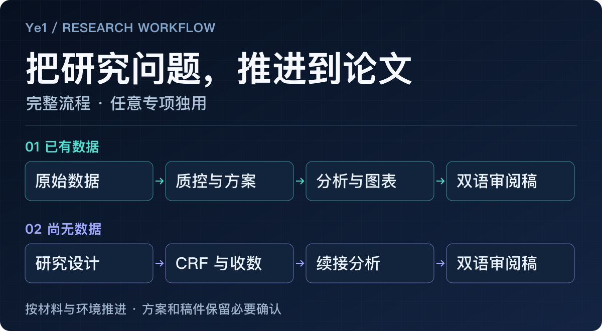
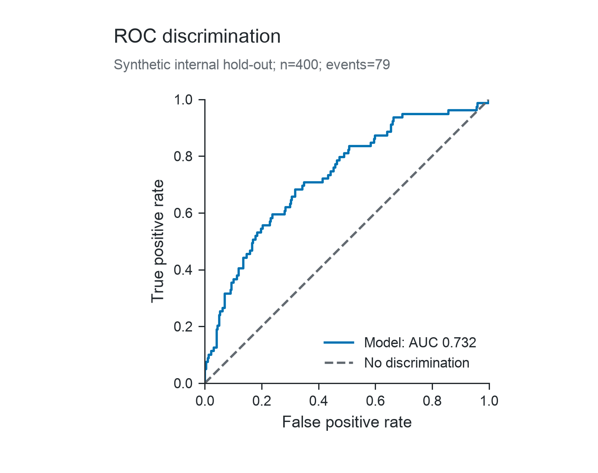
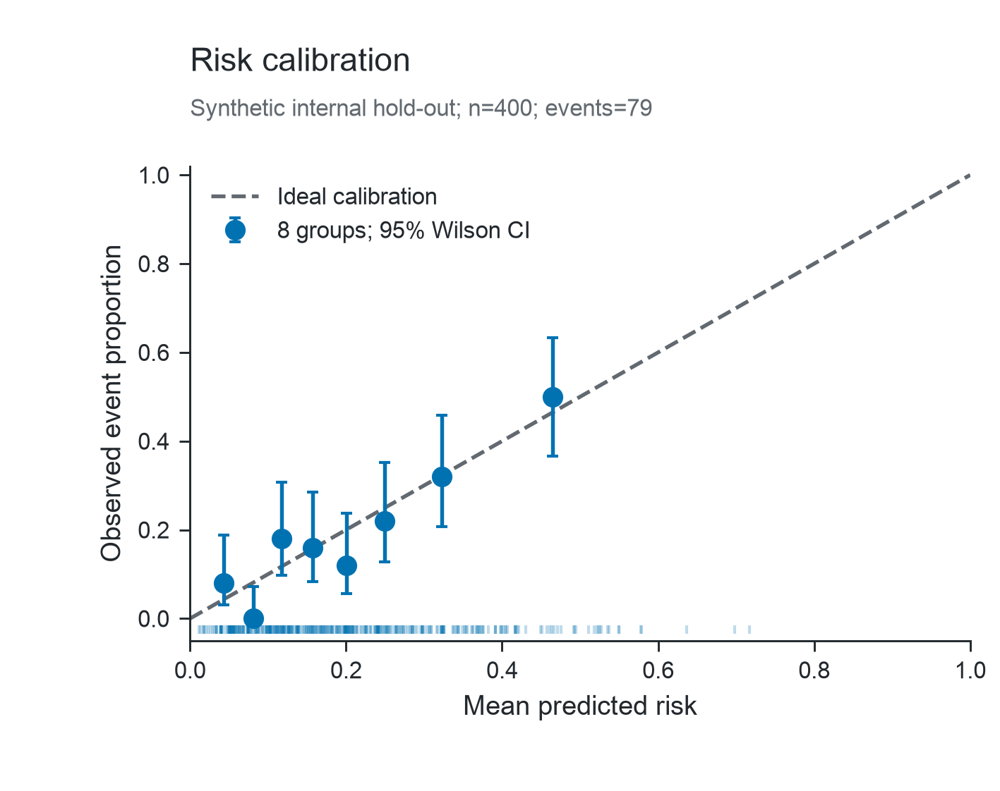
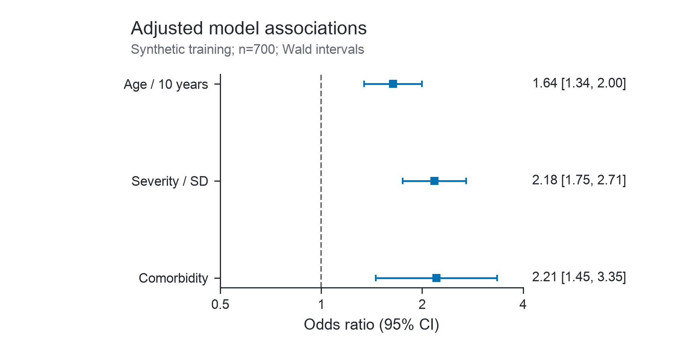
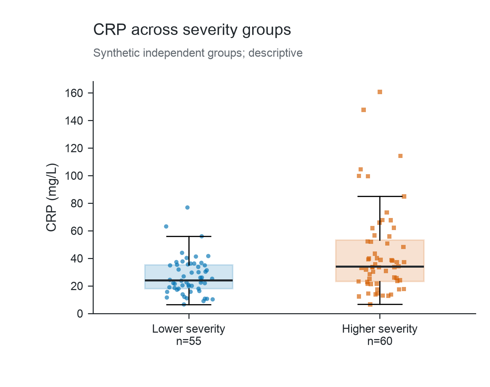
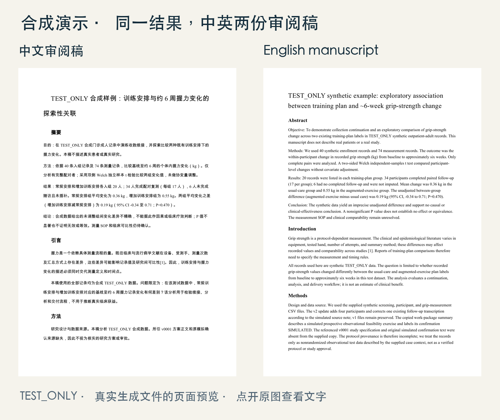
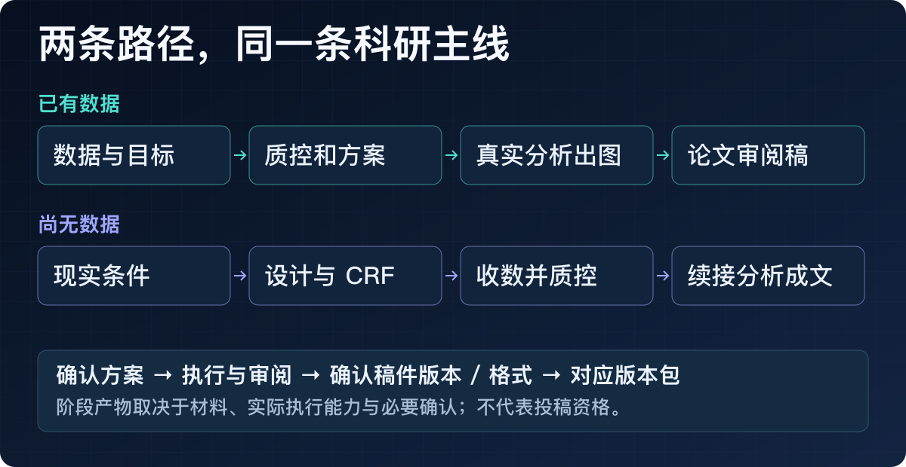

# Ye1 · 医生的科研全流程 Skill

**为医生把研究想法或已有数据，逐步推进为方案、分析、图表和中英文论文审阅稿。**

1个总流程＋37个专项，38个入口都能独立、重复使用。既可以从研究设计走完整流程，也可以只精读一篇论文、检查一张表、画一张图或修改一段文字。

[下载安装与开始使用](#下载安装与开始使用) · [完整38项功能](#完整38项功能) · [实际产出](#实际产出) · [环境与验证范围](#环境与验证范围)

> 已公开的预览候选，源码为 v0.4.4 / privacy-002 + helpfix-001。公开许可证尚未选择，不表示授予修改、商用或再分发权；可下载完整仓库，真实宿主安装仍未实测。真实受控宿主尚未验证；普通Agent不能保证严格执行数据选择，研究数据步骤须暂停。先用公开/合成材料看效果。

## 下载安装与开始使用

**[下载完整仓库ZIP](https://github.com/Nzjye1/ye1-research-skills/archive/refs/heads/main.zip) → 解压 → 选完整Skill目录 → 按宿主官方方式加载。** [项目仓库](https://github.com/Nzjye1/ye1-research-skills)。ZIP是38入口源码集合，不能把仓库根当作一个Skill；这里不提供未经实测的一键安装命令。

1. **选目录。** 解压ZIP后进入仓库根目录；完整流程用 [ye1-research-workflow/](skills/ye1-research-workflow/)；只做某项任务，从下方38项中选择。全部源码在 [skills/](skills/)。
2. **加载。** 保留选定目录中的 `SKILL.md`、`scripts/`、`references/` 等资源，放入宿主能读取的工作区；按宿主官方方式加载完整目录。不能只拷贝一个SKILL.md，也不把总入口的 `modules/*/TASK.md` 重复注册。真实平台安装未测。
3. **提出目标。** 若当前工作区就是解压后的仓库根目录，直接复制下面的请求。若将某个完整Skill目录单独移到工作区，则去掉示例路径开头的 `skills/`。

**只用一项：论文精读**

```text
请读取 skills/ye1-paper-read/SKILL.md 及其要求的规则，使用 Ye1-论文精读。
我会提供一篇公开论文。请先说明实际能读到的正文范围，再整理研究问题、方法、结果和局限，附原文页码或段落位置。
没读到的部分不要补造；只做这次精读，不用先跑科研全流程。
```

**完整流程：从一份数据表开始**

```text
请读取 skills/ye1-research-workflow/SKILL.md 及其相关规则，使用 Ye1-科研全流程。
我想从一份合成Excel开始，先看它能回答什么问题，再逐步完成分析和中英文论文审阅稿。
先说明实际读到的规则、执行能力和数据处理边界；在明确范围前不要读取研究数据。
请先列需要的材料，检查质量并讨论方案；需要我确认方案、稿件版本或格式时说明后再继续。
成果存到独立新项目目录，保留原件；缺材料或能力时交已完成部分与续接点。
```

**还没收数据？** 将示例中的目标换成：“我们门诊每周约能收二十位患者，可做基线和六周随访，人手较少。请先讨论现实可做的方向；方案确认后生成可填写CRF、变量字典和说明，收数后续接分析与写作。”

当前未知宿主不能执行研究数据步骤；示例用于说明目标与材料形态，不表示绕过隐私阻断或已经具备完整运行条件。

[详细加载、升级和移除](docs/USAGE.md) · [环境要求](docs/ENVIRONMENT.md) · [数据使用选择](docs/PRIVACY.md)

## 完整38项功能

**每项都能单独调用，不需要先完成总流程。** 各项仍需自己的材料、必要确认与环境。名称和“独立入口规则”都链接到真实SKILL文档；这里没有尚未制作的教程或视频链接。

| # | 名称 | 一句话功能 | 使用说明 |
|---|---|---|---|
| 1 | [Ye1-科研全流程](skills/ye1-research-workflow/SKILL.md) | 阶段实物、确认记录、完整稿及对应版本包 | [独立入口规则](skills/ye1-research-workflow/SKILL.md) |
| 2 | [Ye1-科研方向梳理](skills/ye1-research-directions/SKILL.md) | 可讨论方向、现实负担与待核点 | [独立入口规则](skills/ye1-research-directions/SKILL.md) |
| 3 | [Ye1-近邻研究比较](skills/ye1-neighbor-comparison/SKILL.md) | 可比性/差异/证据层级比较 | [独立入口规则](skills/ye1-neighbor-comparison/SKILL.md) |
| 4 | [Ye1-发表可行性](skills/ye1-publication-feasibility/SKILL.md) | 七维报告及继续/补证/调整理由 | [独立入口规则](skills/ye1-publication-feasibility/SKILL.md) |
| 5 | [Ye1-研究方案设计](skills/ye1-study-design/SKILL.md) | 方案副本、取舍、对应确认记录 | [独立入口规则](skills/ye1-study-design/SKILL.md) |
| 6 | [Ye1-统计分析方案](skills/ye1-statistical-plan/SKILL.md) | 主要/次要方法、缺失与敏感性计划 | [独立入口规则](skills/ye1-statistical-plan/SKILL.md) |
| 7 | [Ye1-样本量规划](skills/ye1-sample-size/SKILL.md) | 适用方法的真实样本量结果或待补假设方案 | [独立入口规则](skills/ye1-sample-size/SKILL.md) |
| 8 | [Ye1-CRF设计](skills/ye1-crf-design/SKILL.md) | 可填写CRF、字典、填写及校验规则 | [独立入口规则](skills/ye1-crf-design/SKILL.md) |
| 9 | [Ye1-收数与续接](skills/ye1-collection-resume/SKILL.md) | 进度、当前版本QC与可接收交接 | [独立入口规则](skills/ye1-collection-resume/SKILL.md) |
| 10 | [Ye1-数据字典](skills/ye1-data-dictionary/SKILL.md) | 字典、编码/单位/时点及待核项 | [独立入口规则](skills/ye1-data-dictionary/SKILL.md) |
| 11 | [Ye1-数据质控](skills/ye1-data-qc/SKILL.md) | 问题位置、缺失/重复/单位/时间反馈 | [独立入口规则](skills/ye1-data-qc/SKILL.md) |
| 12 | [Ye1-数据清洗](skills/ye1-data-clean/SKILL.md) | 新清洗副本、原件留存及变更日志 | [独立入口规则](skills/ye1-data-clean/SKILL.md) |
| 13 | [Ye1-描述统计](skills/ye1-descriptive/SKILL.md) | 真实基线/描述表、缺失分母及作图数据 | [独立入口规则](skills/ye1-descriptive/SKILL.md) |
| 14 | [Ye1-关联分析](skills/ye1-association/SKILL.md) | 适用比较/回归的真实结果与方法记录 | [独立入口规则](skills/ye1-association/SKILL.md) |
| 15 | [Ye1-预测模型](skills/ye1-prediction/SKILL.md) | 实际模型、留出概率/评价与适用限制 | [独立入口规则](skills/ye1-prediction/SKILL.md) |
| 16 | [Ye1-结果解读](skills/ye1-results/SKILL.md) | 结果解释或局部Results，标未复算范围 | [独立入口规则](skills/ye1-results/SKILL.md) |
| 17 | [Ye1-分析更新](skills/ye1-analysis-update/SKILL.md) | 受影响重算、基线保留与下游失效记录 | [独立入口规则](skills/ye1-analysis-update/SKILL.md) |
| 18 | [Ye1-文献检索](skills/ye1-literature-search/SKILL.md) | 真实可用工具的查询/筛选记录与候选来源 | [独立入口规则](skills/ye1-literature-search/SKILL.md) |
| 19 | [Ye1-论文精读](skills/ye1-paper-read/SKILL.md) | 问题/方法/结果/局限及实际阅读位置 | [独立入口规则](skills/ye1-paper-read/SKILL.md) |
| 20 | [Ye1-证据定位](skills/ye1-evidence-locate/SKILL.md) | 真实段落/表图位置及未见范围 | [独立入口规则](skills/ye1-evidence-locate/SKILL.md) |
| 21 | [Ye1-文献核真](skills/ye1-reference-verify/SKILL.md) | 身份字段MATCH/MISMATCH/UNVERIFIED | [独立入口规则](skills/ye1-reference-verify/SKILL.md) |
| 22 | [Ye1-论据核查](skills/ye1-claim-check/SKILL.md) | 支持/冲突/不支持及位置和边界 | [独立入口规则](skills/ye1-claim-check/SKILL.md) |
| 23 | [Ye1-补充引用](skills/ye1-citation-supplement/SKILL.md) | 引用建议、新段及支持位置/缺口 | [独立入口规则](skills/ye1-citation-supplement/SKILL.md) |
| 24 | [Ye1-引用整理](skills/ye1-reference-align/SKILL.md) | 对应/去重/编号副本与异常清单 | [独立入口规则](skills/ye1-reference-align/SKILL.md) |
| 25 | [Ye1-统计绘图](skills/ye1-statistical-plot/SKILL.md) | 实际PNG/SVG/PDF图及数据回执 | [独立入口规则](skills/ye1-statistical-plot/SKILL.md) |
| 26 | [Ye1-预测评价图](skills/ye1-prediction-plots/SKILL.md) | 适用ROC/PR/校准/DCA真实图及限制 | [独立入口规则](skills/ye1-prediction-plots/SKILL.md) |
| 27 | [Ye1-图形重绘](skills/ye1-figure-redraw/SKILL.md) | 保数值的新样式图；位图缺底数只能受限处理 | [独立入口规则](skills/ye1-figure-redraw/SKILL.md) |
| 28 | [Ye1-图表注释](skills/ye1-figure-caption/SKILL.md) | 中英图题/表题/注释副本与待核项 | [独立入口规则](skills/ye1-figure-caption/SKILL.md) |
| 29 | [Ye1-完整论文](skills/ye1-full-manuscript/SKILL.md) | 完整中/英文审阅文本与来源和缺项 | [独立入口规则](skills/ye1-full-manuscript/SKILL.md) |
| 30 | [Ye1-章节写作](skills/ye1-section-write/SKILL.md) | 新章节/段落及依据、保留范围外文字 | [独立入口规则](skills/ye1-section-write/SKILL.md) |
| 31 | [Ye1-论文润色](skills/ye1-manuscript-edit/SKILL.md) | 干净新段、差异和事实保真核对 | [独立入口规则](skills/ye1-manuscript-edit/SKILL.md) |
| 32 | [Ye1-学术翻译](skills/ye1-academic-translate/SKILL.md) | 保数字/单位/证据强度的译稿 | [独立入口规则](skills/ye1-academic-translate/SKILL.md) |
| 33 | [Ye1-摘要优化](skills/ye1-abstract-edit/SKILL.md) | 实际写/改/压缩摘要与关键结果核对 | [独立入口规则](skills/ye1-abstract-edit/SKILL.md) |
| 34 | [Ye1-全文一致性](skills/ye1-manuscript-consistency/SKILL.md) | 事实位置对照、冲突及修订建议/副本 | [独立入口规则](skills/ye1-manuscript-consistency/SKILL.md) |
| 35 | [Ye1-审阅排版](skills/ye1-review-format/SKILL.md) | 实际Word/Markdown和可支持PDF审阅件 | [独立入口规则](skills/ye1-review-format/SKILL.md) |
| 36 | [Ye1-初稿打包](skills/ye1-draft-package/SKILL.md) | 对应版本/格式绑定初稿包；未确认阻断 | [独立入口规则](skills/ye1-draft-package/SKILL.md) |
| 37 | [Ye1-投稿材料](skills/ye1-submission-materials/SKILL.md) | Cover letter/Highlights/声明草稿与待核 | [独立入口规则](skills/ye1-submission-materials/SKILL.md) |
| 38 | [Ye1-审稿回复](skills/ye1-reviewer-response/SKILL.md) | 逐点回复、真实改动位置与待做清单 | [独立入口规则](skills/ye1-reviewer-response/SKILL.md) |

独立调用任意一项：把下列模板中的名称和路径换成上表对应入口。打开该项规则即可看到适用输入、步骤与交付要求；已有外部方案、结果或稿件可以直接使用。

```text
请读取 skills/[兼容标识]/SKILL.md 及其要求的规则，使用 [Ye1-功能名称]。
我的目标是：[本次任务]；准备提供：[材料]。
先说明可读范围、数据处理边界和必要缺项，再只完成这一项；需要方案或版本确认时明确提出。
重复使用请保留旧成果，输出新版本。
```

[逐项输入、交付与执行条件](docs/FUNCTIONS.md)

## 实际产出



下面是Skill图形模块**实际生成的历史v0.2合成图**，按原字节展示；不是人工重绘，也不代表最新privacy-002全测或临床效果。

| ROC：固定模型内部留出判别 | 校准：预测风险与观察比例 |
|---|---|
| [](assets/skill-generated/roc.png) | [](assets/skill-generated/calibration.png) |
| 森林图：调整OR与95% CI | 箱线＋散点：分组分布 |
| [](assets/skill-generated/forest.png) | [](assets/skill-generated/distribution.png) |

ROC与校准来自400例合成内部留出集，森林图来自相应700例合成训练集；分布图为另一个独立场景。图型按问题和数据前提选择，不为好看追加分析。[版本、方法与随图数据](examples/GRAPHICS.md)

下面的双语稿来自**历史v0.4.3合成握力案例**，与上面的预测/分布场景分开，不把四图拼成同一研究。原稿保留TEST_ONLY与方案、测量定义等未决项；用于展示文件形态，不代表可投稿。



[中文PDF](examples/manuscript-zh.pdf) · [英文PDF](examples/manuscript-en.pdf) · [Word与案例说明](examples/README.md) · [原握力图](assets/demo-figure-zh.png) · [未决项](examples/open-items.md)

<details>
<summary>两种起点如何衔接同一条主线</summary>

已有表：目标沟通、质量检查、研究/近邻可行性、方案确认，再清洗计算、出图、核文献、写中英文稿与全文一致性检查；具备条件时出Word/PDF，绑定确认版本后打包。

尚无数据：从科室、患者来源、可收信息、随访与人手讨论研究设计；确认后生成CRF/字典，收数返表核当前版本与质量，再接分析和写作。



流程图为原创示意。每一步按真实材料、必要确认和宿主能力推进。

</details>

## 环境与验证范围

这是供AI Agent读取的Skill及辅助脚本，不自带模型或运行环境。医生电脑没有Python，与宿主没有执行器，是两回事。

| 任务 | 所需条件 | 缺少时能做什么 |
|---|---|---|
| 阅读、写作、翻译、解读已有结果 | 宿主实际读到文本 | 处理可读内容，标未读/未复算范围 |
| 新文献检索与核验 | 可用网络或已提供权威材料 | 处理已有证据，保留待核项 |
| Excel/CRF/QC | 文件执行、Python 3.11+，按任务需openpyxl | 交材料清单和已可读内容 |
| 支持范围内统计 | 可执行代码、现有Rscript/jsonlite等 | 方案与已有可信结果解释 |
| 科研绘图 | NumPy/Matplotlib、真实底数 | 保留结果表与冻结底数，待续绘图 |
| Word/PDF | python-docx、适用字体；PDF另需LibreOffice/Poppler及布局适配 | Markdown/文本审阅稿 |

无Python/执行器时，不声称已重算、绘图、哈希或导出；不自动装依赖，不为兼容性转云上传原件。Codex、豆包、WorkBuddy、Claude Code等真实平台注册/安装与Windows/Linux均未测，不承诺通用兼容。[完整环境条件](docs/ENVIRONMENT.md)

已有38入口结构与有限工程路径证据，**没有38项全部端到端验收，旧科学审核仍为PARTIAL**。privacy-002有界竞态修复已获独核接纳，真实受控宿主、可信审阅与实际发送仍未验证。真实医生自主使用、复杂统计及期刊终稿仍待验证，不保证录用、不自动投稿。[已测与未测](docs/STATUS.md)

数据使用保留A/B选择：A只回传经检查且获准的汇总/稿件/图，B限定指定数据版本、平台/模型与目的。普通任意文件/shell的Agent不能由提示词保证严格执行，未知宿主暂停研究数据步骤；已交云端附件不能事后撤回。[隐私说明](docs/PRIVACY.md)

## 发布与许可

当前通用版按免费方向准备；宿主订阅、模型API和执行环境可能另收费。旧物化内核的权属/公开范围与产品条款仍待确认，不宣称MIT、Apache或可任意再分发。[许可与来源](docs/RIGHTS.md)

正式仓库与ZIP下载见上方；经实测的宿主安装方法、最终许可及适用范围仍待补充。详细状态页保留出包前证据时点，当前公开可用性以本页为准；公开预览不改变科学PARTIAL与隐私条件。

2026-10-15 UTC：依据用户“一句话介绍、完整功能目录、安装方式”的本地文档要求整理；只参考结构，未复制参考项目宣传措辞或许可。现已公开预览，未选许可证，算法与历史图稿不变。


本地候选增量（2026-10-15 UTC）：helpfix-001仅修复graphics_worker、nutrition_graphics及safe_run的帮助入口。纯帮助在输入读取/输出写入/绘图导入前退出；实际执行仍需项目选择和受控适配器。科学方法、全部38功能与历史图稿不变。本候选现已公开为预览版本；未选择MIT或其他许可证。
