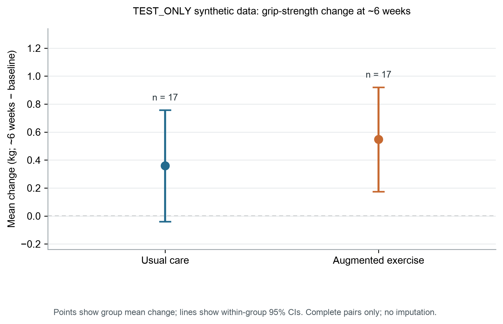

# TEST_ONLY synthetic example: exploratory association between training plan and ~6-week grip-strength change

## Abstract

Objective: To demonstrate collection continuation and an exploratory comparison of grip-strength change across two existing training-plan labels in TEST_ONLY synthetic outpatient-adult records. This manuscript does not describe real patients or a real study.

Methods: We used 40 synthetic enrollment records and 74 measurement records. The outcome was the within-participant change in recorded grip strength (kg) from baseline to approximately six weeks. Only complete pairs were analyzed. A two-sided Welch independent-samples t test compared participant-level changes without covariate adjustment.

Results: 20 records were listed in each training-plan group. 34 participants completed paired follow-up (17 per group); 6 had no completed follow-up and were not imputed. Mean change was 0.36 kg in the usual-care group and 0.55 kg in the augmented-exercise group. The unadjusted between-group difference (augmented exercise minus usual care) was 0.19 kg (95% CI, -0.34 to 0.71; P=0.470).

Conclusion: The synthetic data yield an imprecise unadjusted difference and support no causal or clinical-effectiveness conclusion. A nonsignificant P value does not establish no effect or equivalence. The measurement SOP and clinical comparability remain unresolved.

## Introduction

Grip strength is a protocol-dependent measurement. The clinical and epidemiological literature varies in equipment, tested hand, number of attempts, and summary method; these differences may affect recorded values and comparability across studies [1]. Reports of training-plan comparisons therefore need to specify the measurement and timing rules.

All records used here are synthetic TEST_ONLY data. The question is limited to whether recorded grip-strength values changed differently between the usual-care and augmented-exercise plan labels from baseline to approximately six weeks in this test dataset. The analysis evaluates a continuation, analysis, and delivery workflow; it is not an estimate of clinical benefit.

## Methods

Design and data source. We used the supplied synthetic screening, participant, and grip-measurement CSV files. The v2 update adds four participants and corrects one existing follow-up transcription according to the simulated source note; v1 files remain preserved. The copied work-package summary describes a simulated prospective observational feasibility exercise and labels its confirmation SIMULATED. The referenced v0001 study specification and original simulated confirmation text were absent from the supplied copy. The protocol provenance is therefore incomplete; we treat the records only as nonrandomized observational test data described by the supplied case context, not as a verified protocol or study approval.

Participants and groups. The synthetic screening table listed 40 records, all marked eligible and enrolled. The participant table contained 20 records under each training-plan label. The case context states that groups were not randomized. Eligibility criteria, site, recruitment dates, exercise content, dose, adherence, and co-interventions were not supplied.

Outcome and measurement. The outcome was recorded grip strength in kilograms; change was defined as the approximately six-week value minus baseline. Baseline measurements were present for 40 records and approximately six-week measurements for 34; each of the 34 complete pairs had one record at each timepoint, with no repeated timepoint values requiring aggregation. Complete pairs were 40 to 41 days apart (median, 41). All 74 measurements used dominant for hand_side, although the dictionary permits right, left, or unknown; we did not recode the conflict and cannot infer anatomical side. TEST_DEVICE_A and TEST_POSITION_SEATED are synthetic codes, not evidence of an actual device or a complete measurement protocol.

Statistical analysis. The analysis set comprised complete pairs; the 6 incomplete follow-ups remained missing and were not imputed. We calculated each participant's change and compared group means using a two-sided Welch independent-samples t test, with the contrast defined as augmented exercise minus usual care. We report within-group mean changes and t-based 95% confidence intervals. This method was an exploratory run-level choice, not a verified confirmatory statistical analysis plan. No covariate adjustment, sensitivity analysis, or multiplicity correction was performed.

## Results

Sample and follow-up. All 40 synthetic records were listed as enrolled, with 20 per group. 34 completed approximately six-week follow-up (17/20 usual care; 17/20 augmented exercise); 6 did not (3 per group). A reason field was populated for all 6 incomplete records, but reasons were not categorized for this analysis. Complete pairs were 40 to 41 days apart (median, 41). Because no acceptable visit window was specified, timing could not be judged against a protocol-defined window.

Mean age was 56.0 (SD 10.2) years in the usual-care group and 59.0 (SD 10.2) years in the augmented-exercise group. Recorded sex in usual care was 10 female and 10 male records; augmented exercise had 10 female and 10 male records. Baseline grip-strength means were 27.50 (SD 2.07) kg and 27.71 (SD 2.18) kg, respectively. Baseline, follow-up, and within-participant change summaries among complete pairs are shown in Table 1.

Table 1. Recorded grip-strength values and change among complete pairs

| Training plan | Enrolled / paired n | Baseline grip, kg mean (SD) | ~6-week grip, kg mean (SD) | Change mean (SD) and 95% CI, kg |

| --- | --- | --- | --- | --- |

| Usual care | 20 / 17 | 27.50 (2.07) | 27.86 (2.27) | 0.36 (0.77); 95% CI -0.04 to 0.76 |

| Augmented exercise | 20 / 17 | 27.71 (2.18) | 28.26 (2.32) | 0.55 (0.73); 95% CI 0.17 to 0.92 |

Figure 1 displays the group mean within-participant changes and their within-group 95% confidence intervals; participant-level data points are not plotted.

Mean change was 0.55 kg in the augmented-exercise group and 0.36 kg in the usual-care group. The unadjusted difference was 0.19 kg (95% CI, -0.34 to 0.71; Welch test P=0.470). The interval includes differences in either direction; the P value does not show no difference or equivalence.

## Discussion

In these TEST_ONLY synthetic records, mean recorded grip strength increased slightly among complete pairs: 0.36 kg in the usual-care group and 0.55 kg in the augmented-exercise group. The unadjusted difference was 0.19 kg (95% CI, -0.34 to 0.71 kg). The estimate is uncertain and does not identify a causal effect of either training plan.

Measurement choices matter when comparing grip-strength values. The cited review describes variation in tested hand, equipment, attempts, and summary rules, and notes that protocol variation can affect values and comparability [1]. Although paired records here used the same dominant label and the same device and position codes at both timepoints, dominant was not mapped to an allowed right/left/unknown value, and the codes were not linked to a verified operational SOP. Within-pair code consistency cannot replace a clinical measurement definition.

The analysis compares changes under existing nonrandomized plan labels. Baseline characteristics may differ, and the observed contrast could reflect patient selection, training content, co-interventions, or the composition of participants who completed follow-up. These factors were not adjusted for or identified. Clinical importance also cannot be assessed because no diagnosis-specific context or meaningful-change threshold was supplied.

## Limitations

First, all data are synthetic and the sample is small; 6 of 40 records lack follow-up, and the missingness mechanism is unknown. Second, training-plan groups were not randomized and no confounding adjustment was performed. Third, the hand-side values conflict with the dictionary, and the actual tested hand, device, posture details, trial spacing, and summary rule remain undefined despite consistent within-pair codes. Fourth, the median observed interval was 41 days, but no acceptable follow-up window was prespecified. Fifth, the copied v0001 work package lacks its referenced study specification and original simulated confirmation source. No real ethics or institutional approval, consent process, author information, funding, or conflict-of-interest documentation was supplied.

## Conclusions

Among 34 complete synthetic pairs, the unadjusted mean-change difference was 0.19 kg (augmented exercise minus usual care; 95% CI, -0.34 to 0.71; P=0.470). This is an exploratory association and does not demonstrate benefit, absence of benefit, or equivalence. Any real-study interpretation would require verification of the protocol version, side coding, grip-strength SOP, follow-up window, and applicable approvals.

## Declarations

Ethics and consent: This manuscript uses local synthetic TEST_ONLY data and contains no real participant records. The software test provides no evidence of ethics approval or consent for a real study. Any real-data use requires separate verification of applicable approvals and data-use authority.

Data availability: The review package contains aggregate statistics only. It excludes participant-level rows, raw CSV files, and synthetic sentinel identifiers.

Authors, funding, conflicts of interest, and author approval: OPEN; responsible authors must verify these items before any real-study use.

## References

1. Roberts HC, Denison HJ, Martin HJ, Patel HP, Syddall H, Cooper C, Sayer AA. A review of the measurement of grip strength in clinical and epidemiological studies: towards a standardised approach. Age Ageing. 2011;40(4):423-429. doi:10.1093/ageing/afr051. PMID:21624928.
