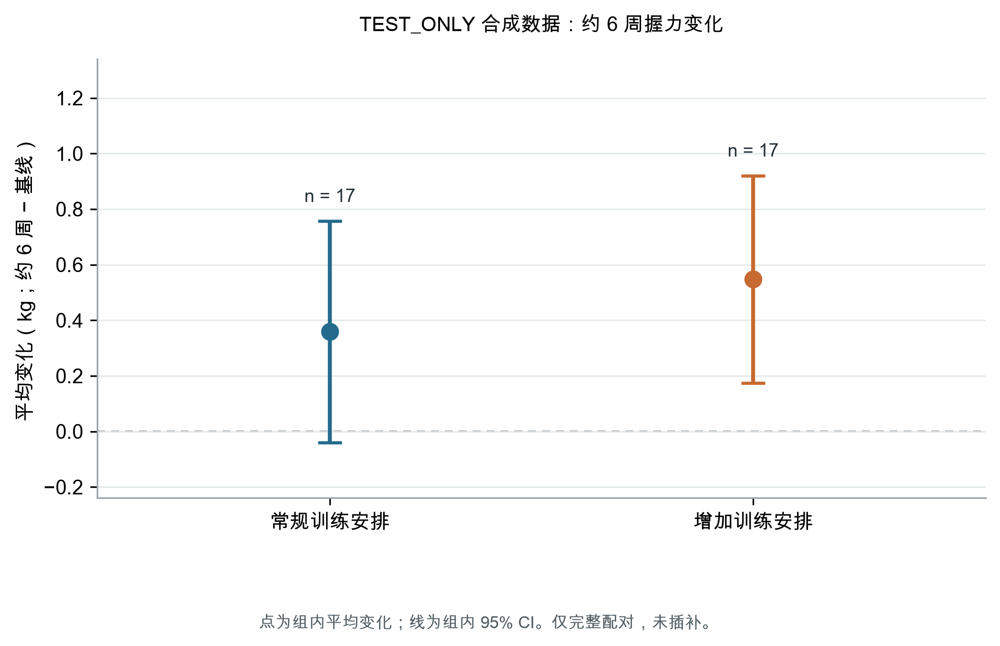

# TEST_ONLY 合成样例：训练安排与约6周握力变化的探索性关联

## 摘要

目的：在 TEST_ONLY 合成门诊成人记录中演练收数续接，并探索比较两种既有训练安排下的握力变化。本稿不描述真实患者或真实研究。

方法：依据 40 条入组记录及 74 条测量记录，比较基线至约 6 周的个体内握力变化（kg）。仅分析有完整配对者；采用双侧 Welch 独立样本 t 检验比较两组变化值，未做协变量调整。

结果：常规安排和增加训练安排各入组 20 人；34 人完成配对复测（每组 17 人），6 人未完成随访且未插补。常规安排组平均变化为 0.36 kg，增加训练安排组为 0.55 kg。两组平均变化之差（增加训练安排减常规安排）为 0.19 kg（95% CI -0.34 至 0.71；P=0.470）。

结论：合成数据给出的未调整组间变化差异不精确，不能据此作因果或临床疗效判断；P 值不显著也不证明无效或等效。测量SOP和临床可比性仍待确认。

## 引言

握力是一个依赖具体测量流程的量。既往临床与流行病学文献在设备、受测手、测量次数及汇总方式上存在差异，这些差异可能影响记录值及研究间可比性[1]。因此，训练安排与握力变化的描述必须同时交代测量定义和时间点。

本稿使用的全部记录均为合成 TEST_ONLY 数据。问题限定为：在该测试数据中，常规训练安排与增加训练安排对应的基线至约 6 周握力记录变化有何差别？该分析用于检验续接、分析和交付流程，不用于推断真实临床获益。

## 方法

研究设计与数据来源。本次使用 TEST_ONLY 合成筛查、参与者和握力测量 CSV。v2 更新加入 4 名新参与者，并按模拟来源说明更正一条既有随访转录记录；v1 文件保留不变。工作包副本将项目描述为 SIMULATED 前瞻性观察可行性演练，但其引用的 v0001 方案和模拟确认原文未提供。因此，本文仅按测试场景处理，不视为核实的真实方案或研究批准。

对象与分组。合成筛查表列出 40 人，均记录为符合条件并入组。参与者表按常规训练安排和增加训练安排各列 20 人。场景说明两组并非随机分配；具体入排标准、地点、招募日期、训练内容、剂量、依从性和共同干预均未提供。

结局与测量。结局为握力记录值（kg）；变化定义为约 6 周记录减去基线记录。40 人有基线测量，34 人有约 6 周测量；这 34 人各有一条基线和一条随访记录，未出现需汇总的重复时点记录。完整配对的测量间隔为 40 至 41 天，中位数 41 天。返表所有 74 条测量均将 hand_side 记为 dominant，但字典允许值为 right、left 或 unknown；未进行重编码，也不能据此确定解剖侧别。TEST_DEVICE_A 与 TEST_POSITION_SEATED 是合成代码，不等同于实际设备或完整测量流程。

统计分析。分析集为具备两时点测量的完整配对者；未完成随访的 6 人保留为缺失，不插补。先计算每人的变化值，再用双侧 Welch 独立样本 t 检验比较两组平均变化，方向为增加训练安排减常规训练安排；同时给出组内变化均值及 t 分布 95% CI。方法选择仅用于本次探索性测试，未作为确认性统计分析计划核实；未进行协变量调整、敏感性分析或多重比较校正。

## 结果

样本与随访。40 人均进入合成入组表，常规安排和增加训练安排各 20 人。34 人完成约 6 周复测（常规安排 17/20，增加训练安排 17/20），另有 6 人未完成（两组各 3 人）；未完成者的原因字段均有记录，但本次未对原因作归类分析。完整配对间隔为 40 至 41 天，中位数 41 天；由于方案未给出可接受的访视窗口，不能将时间间隔判定为临床流程合格。

基线年龄在常规安排组为 56.0（SD 10.2）岁，在增加训练安排组为 59.0（SD 10.2）岁；常规安排组记录性别为女性 10 人、男性 10 人，增加训练安排组分别为女性 10 人、男性 10 人。基线握力均值分别为 27.50（SD 2.07）kg 和 27.71（SD 2.18）kg。各组完整配对者的基线、随访和个体内变化摘要见表1。

表1 完整配对者的握力记录与变化摘要

| 训练安排 | 入组/完整配对 n | 基线握力，kg 均值（SD） | 约6周握力，kg 均值（SD） | 变化均值（SD）及95% CI，kg |

| --- | --- | --- | --- | --- |

| 常规训练安排 | 20 / 17 | 27.50 (2.07) | 27.86 (2.27) | 0.36 (0.77)；95% CI -0.04 至 0.76 |

| 增加训练安排 | 20 / 17 | 27.71 (2.18) | 28.26 (2.32) | 0.55 (0.73)；95% CI 0.17 至 0.92 |

图1展示两组完整配对者的平均个体内变化及其组内 95% CI；图中不显示参与者级数据点。

组间比较中，增加训练安排组平均变化为 0.55 kg，常规安排组为 0.36 kg；未调整均值差为 0.19 kg（95% CI -0.34 至 0.71；Welch 检验 P=0.470）。该区间同时包含负向和正向差异，不能据 P 值得出无差异或等效结论。

## 讨论

在这组 TEST_ONLY 合成记录中，完整配对者的平均握力记录均较基线略高：常规安排组 0.36 kg，增加训练安排组 0.55 kg。两组未调整差值为 0.19 kg，95% CI 为 -0.34 至 0.71 kg。结果的不确定性较大，数据不支持将差异解释为训练方案的因果效果。

握力测量的受测手、设备、试次和汇总规则会影响记录值及研究间可比性[1]。本数据虽然在每位完整配对者内保持相同的 dominant、设备代码和体位代码，但 dominant 未映射至字典允许的左右/未知类别，代码也没有配套到可核实的实际SOP。因此，配对记录的一致性不能替代临床测量定义。

这次分析只比较现有非随机训练安排标签下的变化。年龄等基线特征可能不同，组间差异也可能反映患者选择、训练内容、共同治疗或随访完成者构成；本次没有调整或识别这些因素。观察到的均值变化也不能与临床重要变化阈值比较，因为该场景没有提供阈值或疾病背景。

## 局限

第一，数据完全合成，样本量仅 40 人，其中 6 人无随访；结果不代表真实门诊人群。第二，训练安排非随机且未调整混杂因素，缺失随访机制未知。第三，握力侧别字段与字典冲突，尽管完整配对内部代码一致，实际测量手、设备、体位细节、试次间隔和汇总规则仍未定义。第四，观察间隔中位数为 41 天，但允许窗口未预先给定。第五，复印的 v0001 工作包不含其引用的方案正文与原始模拟确认来源；伦理/机构审批、真实同意流程、作者信息、资金和利益冲突声明也没有真实研究材料可核。

## 结论

本 TEST_ONLY 合成样例中，34 名完整配对者的平均变化差为 0.19 kg（增加训练安排减常规安排；95% CI -0.34 至 0.71；P=0.470）。这是未调整的探索性关联，不证明有或没有训练效果，也不证明两组等效。任何真实研究解释均须先核实方案版本、字典侧别、握力测量SOP、随访窗口及必要审批。

## 声明

研究对象与伦理：本文使用本地合成 TEST_ONLY 数据，不含真实参与者资料；该测试不提供任何真实研究伦理批准或同意证据。若改用真实数据，适用审批与数据使用权限须另行核实。

数据可得性：审阅包只含汇总统计，不含参与者级行、原始CSV或合成哨兵标识。

作者、基金、利益冲突及作者确认：OPEN，需在任何真实研究使用前由责任作者补充核实。

## 参考文献

1. Roberts HC, Denison HJ, Martin HJ, Patel HP, Syddall H, Cooper C, Sayer AA. A review of the measurement of grip strength in clinical and epidemiological studies: towards a standardised approach. Age Ageing. 2011;40(4):423-429. doi:10.1093/ageing/afr051. PMID:21624928.
